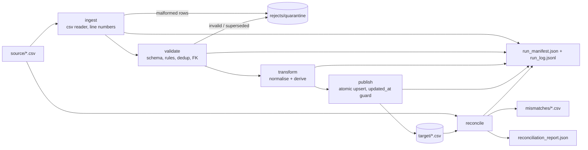

# PLAN.md — YottaFlex AI Candidate Project: Source-to-Target Reconciliation Tool

> **How to use this file**
> - **For the CLI agent (Antigravity or any coding agent):** Read Parts 0–9 fully, then build phase by phase. Do not skip the gates. Obey the rules in Part 0.
> - **For me (the candidate):** Part 10 onward is the study guide, demo script and interview Q&A. Part 11 is the daily checklist.
> - Put a copy of this file in the repo as `docs/PLAN.md`. It is a legitimate "supporting artifact" and shows structured planning.

---

## PART 0 — Rules for the agent (read first)

1. **Goal:** a *complete, tested vertical slice* — not an enterprise system. Correctness, clarity, tests and documentation beat features.
2. **Stack (fixed, do not change):** Python 3.11+, `pandas`, `numpy`, `pytest`. Standard library for everything else (`csv`, `hashlib`, `json`, `argparse`, `logging`, `sqlite3` not needed). No cloud, no secrets, no network calls.
3. **Never fabricate results.** Any number in the README, `docs/PERFORMANCE.md` or the demo must come from a real command run. Paste the actual output into `docs/evidence/`.
4. **Commit after every phase** with the commit message given. Small, meaningful commits (reviewers read git history).
5. **Log every prompt** the human gives you into `prompts/PROMPT_HISTORY.md` (append, timestamped). Do not edit past entries.
6. **Keep functions small and typed**, with docstrings explaining *why*, not just what. Prefer readability over cleverness.
7. After each phase run `pytest -q`. Do not start the next phase while tests fail.
8. Naming: `snake_case` for files, tables, columns. Timestamps ISO-8601 UTC with `Z`. IDs deterministic. Lineage fields `run_id`, `source_file`.
9. Do not commit generated large data (`data/large/`, `output/`). Do commit the small sample, its expected labels, and one sample output set under `sample_output/`.
10. When something in this plan is ambiguous, pick the simplest option, and record it in `docs/DESIGN_NOTES.md` under "Assumptions".

---

## PART 1 — The problem in one paragraph

Given a **source** dataset and a **target** dataset, produce a **machine-readable reconciliation report** using (a) row counts, (b) business keys, (c) aggregates, (d) field-level checks, and **isolate every mismatched record** into separate files. Around that: ingestion, validation, reject/quarantine path, transformation, idempotent publishing, run logging, tests, sample + 100k+ generator, performance measurement with one optimisation, README, data dictionary, design/trade-off note, AI-usage disclosure and prompt history.

### Requirement → where it is satisfied (traceability matrix)

| # | Requirement from the brief | Satisfied by |
|---|---|---|
| 1 | Source/target schemas, types, keys, assumptions | `src/recon/schemas.py`, `docs/DATA_DICTIONARY.md` |
| 2 | Reproducible sample + scalable generator | `src/recon/generator.py`, `data/sample/`, `make large` |
| 3 | Ingest, validate, transform, publish | `ingest.py`, `validate.py`, `transform.py`, `publish.py` |
| 4 | Safe reruns, run status, counts, rejects, errors | `runlog.py`, deterministic `run_id`, upsert publish |
| 5 | Automated tests + demo reports | `tests/`, `make demo`, `docs/evidence/` |
| 6 | Row count / key / aggregate / field recon | `reconcile.py` |
| 7 | Machine-readable report + isolated mismatches | `report.py` → JSON + CSVs |
| 8 | Edge cases (malformed, missing, dup, schema change, empty, partial failure, late data, bad FK, rerun) | Part 6 test matrix |
| 9 | Performance measurement + 1 optimisation | `scripts/benchmark.py`, `docs/PERFORMANCE.md` |
| 10 | AI transparency | `prompts/PROMPT_HISTORY.md`, `docs/AI_USAGE.md` |

---

## PART 2 — Domain design (decisions already made)

**Domain:** e-commerce orders. Two entities give us a real foreign-key check without bloat.

### Entities
| Entity | Grain | Primary / business key | Relationships |
|---|---|---|---|
| `customers` | one row per customer | `customer_id` | parent |
| `orders` | one row per order (latest version) | `order_id` | `orders.customer_id` → `customers.customer_id` |

### Source schemas (CSV, all read as strings, then validated)

**`customers.csv`**
| column | type | null? | rule |
|---|---|---|---|
| customer_id | str | no | PK, regex `^C\d{6}$` |
| customer_name | str | no | non-empty after trim |
| email | str | yes | lower-cased in target |
| country_code | str | no | 2 letters, upper in target |
| created_at | timestamp | no | ISO-8601, offset allowed |
| updated_at | timestamp | no | ISO-8601, ≥ created_at |

**`orders.csv`**
| column | type | null? | rule |
|---|---|---|---|
| order_id | str | no | PK, regex `^O\d{8}$` |
| customer_id | str | no | FK to customers (valid, non-rejected) |
| order_ts | timestamp | no | ISO-8601; not in the future |
| status | str | no | trim+lower ∈ {created, paid, shipped, delivered, cancelled, refunded} |
| amount | decimal | no | `0.00 ≤ amount ≤ 1,000,000.00`, rounded to 2 dp |
| currency | str | no | trim+upper ∈ {USD, EUR, INR, GBP} |
| updated_at | timestamp | no | version timestamp (used for dedup and late data) |

### Target schemas (derived, deterministic)

**`dim_customers`**: `customer_id, customer_name (trimmed), email (lower or null), country_code (upper), created_at_utc, updated_at_utc, source_file, run_id`

**`fact_orders`**: `order_id, customer_id, order_ts_utc, order_date (UTC date), status (lower), amount (2dp), currency (upper), amount_band, updated_at_utc, source_file, run_id`

- `amount_band`: `low` if amount < 100, `medium` if < 1000, else `high`.
- All timestamps converted to UTC and written as `YYYY-MM-DDTHH:MM:SSZ`.
- **Lineage columns** (`run_id`, `source_file`) are **excluded** from reconciliation comparison; all others are compared.

### Key business rules (write these in the README)
1. **Duplicates:** for the same key, keep the row with the greatest `updated_at` (tie → last in file). Others go to quarantine with `DUPLICATE_SUPERSEDED`. This also handles **out-of-order** files.
2. **Late-arriving data:** publish is an *upsert guarded by `updated_at`* — an incoming row only overwrites a target row if `incoming.updated_at >= target.updated_at`. A late, older version never clobbers newer data (it is counted as `skipped_stale`).
3. **History:** superseded versions are not silently dropped — they are written to the rejects/quarantine file with their source line number and `run_id`, so history is traceable.
4. **Referential integrity:** an order whose `customer_id` is not among *valid* customers is rejected `INVALID_FK` (not silently loaded).
5. **Run determinism:** `run_id = "run_" + sha256(all input file bytes + PIPELINE_VERSION)[:12]`. Same input → same `run_id`.

### Reject reason codes (constants in `schemas.py`)
`MALFORMED_ROW`, `MISSING_REQUIRED`, `INVALID_TYPE`, `INVALID_FORMAT`, `INVALID_VALUE` (e.g. negative amount, bad status/currency), `FUTURE_TIMESTAMP`, `INVALID_FK`, `DUPLICATE_SUPERSEDED`.
File-level failures: `SCHEMA_MISSING_COLUMNS`, `EMPTY_FILE_NO_HEADER`, `FILE_NOT_FOUND`.

Each reject row contains: `run_id, source_file, source_line_number, entity, business_key, reason_code, reason_detail, raw_record`.

---

## PART 3 — Repository layout (create exactly this)

```
yottaflex-recon/
├── README.md
├── PLAN.md                      # (copy also in docs/PLAN.md)
├── Makefile
├── requirements.txt             # pandas, numpy, pytest
├── pyproject.toml               # minimal; pytest config, package = recon
├── .gitignore                   # output/, data/large/, __pycache__/, .venv/
├── src/recon/
│   ├── __init__.py              # PIPELINE_VERSION = "1.0.0"
│   ├── __main__.py              # python -m recon
│   ├── cli.py                   # argparse: generate | run | reconcile
│   ├── config.py                # dataclasses: PipelineConfig, ReconConfig
│   ├── schemas.py               # column specs, enums, reject codes
│   ├── ingest.py                # read CSV safely -> rows + malformed rejects
│   ├── validate.py              # rules -> valid df + rejects df
│   ├── transform.py             # deterministic normalisation + derived fields
│   ├── publish.py               # atomic, idempotent, updated_at-guarded upsert
│   ├── reconcile.py             # counts, keys, aggregates, field-level
│   ├── report.py                # write JSON + mismatch CSVs
│   ├── runlog.py                # run_id, manifest, run_log.jsonl, logging setup
│   ├── generator.py             # seeded data + defect injection + labels
│   └── errors.py                # custom exceptions (SchemaError, etc.)
├── tests/
│   ├── conftest.py              # tmp_path fixtures, tiny builders
│   ├── test_ingest.py
│   ├── test_validate.py
│   ├── test_transform.py
│   ├── test_publish_idempotency.py
│   ├── test_reconcile.py
│   ├── test_generator_labels.py # recon output == injected labels
│   ├── test_edge_cases.py       # schema change, empty, partial failure
│   └── test_end_to_end.py
├── scripts/benchmark.py
├── data/
│   ├── sample/
│   │   ├── source/{customers.csv, orders.csv}
│   │   ├── target_drifted/{dim_customers.csv, fact_orders.csv}
│   │   └── expected/expected_findings.json   # labels, SEPARATE from inputs
│   └── large/                   # gitignored
├── sample_output/               # committed result of `make demo`
├── docs/
│   ├── DATA_DICTIONARY.md
│   ├── DESIGN_NOTES.md          # trade-offs, assumptions, limitations, next steps
│   ├── PERFORMANCE.md
│   ├── AI_USAGE.md
│   ├── INTERVIEW_CHEATSHEET.md  # copy of Part 10+ of this plan
│   ├── architecture.md          # ASCII/mermaid diagram
│   └── evidence/                # pasted real outputs: pytest, demo, benchmark
└── prompts/PROMPT_HISTORY.md
```

---

## PART 4 — Architecture (put in `docs/architecture.md` and README)



Two usage modes:
- **Mode A — `recon run` then `recon reconcile`**: the pipeline builds the target; reconcile should show **0 unexplained differences** (rejected rows explain count gaps).
- **Mode B — `recon reconcile` on `target_drifted/`**: an independently produced target with deliberately injected defects; reconcile must find *exactly* the labelled defects.

### How reconcile works (core idea — memorise this)
1. Load raw source. Run ingest+validate+transform **in memory** → `expected_target` and `rejects`.
2. Load actual target.
3. **Count equation:** `source_raw_rows = expected_target_rows + rejected_rows` (rejected includes superseded duplicates). Then compare `expected_target_rows` vs `actual_target_rows`; any gap is *unexplained*.
4. **Key check:** set differences on business key → `missing_in_target`, `extra_in_target`; duplicates in target (`duplicate_in_target`).
5. **Aggregates** (with tolerance): row count, `sum(amount)`, `min/max(amount)`, `count_distinct(customer_id)`, count per `status`, `min/max(order_ts_utc)` for orders; row count, distinct countries for customers.
6. **Field-level:** inner-join on key; compare each non-lineage column using normalised comparison (amount within `0.005`, strings exact after trim, timestamps parsed). Emit long-format rows `(entity, business_key, column, source_value, target_value, mismatch_type)`.
7. Write JSON report + CSVs; exit code `0` pass / `1` mismatches / `2` failure.

---

## PART 5 — Phased build plan (agent: follow in order)

### Phase 1 — Scaffold & docs skeleton  *(~1 h)*
- Create layout from Part 3, `requirements.txt`, `pyproject.toml`, `.gitignore`, `Makefile` with targets: `setup`, `test`, `sample`, `demo`, `large`, `bench`, `clean`.
- `Makefile` targets must work on a clean clone: `python -m venv .venv && .venv/bin/pip install -r requirements.txt`.
- Stub README with headings; create `prompts/PROMPT_HISTORY.md`.
- **Gate:** `pytest -q` runs (0 tests OK). **Commit:** `chore: scaffold project structure, makefile, docs skeleton`

### Phase 2 — Schemas, config, errors, run log  *(~1.5 h)*
- `schemas.py`: dict-based column specs (name, type, required, regex/enum), reject code constants, lineage columns list, `RECON_EXCLUDE_COLUMNS`.
- `config.py`: dataclasses with defaults — `amount_tolerance=0.005`, `max_amount=1_000_000`, `allowed_status`, `allowed_currency`, `now_utc` injectable (for testing the future-timestamp rule).
- `runlog.py`: `compute_run_id(paths)`, `RunContext` (context manager recording start/end, counts, status, failure_reason, attempt number), writes `run_manifest.json` and appends one JSON line per attempt to `run_log.jsonl`. Python `logging` with run_id in format.
- **Gate:** unit test that same bytes → same run_id, different bytes → different. **Commit:** `feat: schemas, config and deterministic run id + run log`

### Phase 3 — Ingest  *(~1.5 h)*
- Use stdlib `csv` reader line by line. For each row record `source_line_number`.
- Header check: missing required columns → raise `SchemaError("SCHEMA_MISSING_COLUMNS: ...")`; extra columns → log warning, ignore (documented policy). Zero-byte file → `EMPTY_FILE_NO_HEADER`. Header-only file → empty batch, success with 0 rows.
- Wrong field count → reject `MALFORMED_ROW` with the raw line. Handle quoted commas, blank lines (skip), BOM (`utf-8-sig`).
- Returns `(DataFrame of str, rejects DataFrame)`.
- **Gate:** tests in `test_ingest.py`. **Commit:** `feat: resilient CSV ingest with malformed-row quarantine and schema drift detection`

### Phase 4 — Validate  *(~2 h)*
- Per-row checks in this order: required → format/regex → type (decimal, timestamp) → value rules (amount range, status, currency, future ts) .
- Vectorised where easy (pandas masks), reason code per failing row (first failing rule wins; also keep `reason_detail`).
- Dedup (Part 2 rule 1) → superseded rows to rejects.
- FK check: orders vs valid customers → `INVALID_FK`.
- Return `(valid_df, rejects_df)`; **invariant:** `len(input) == len(valid) + len(rejects)` — assert it and test it.
- **Gate:** `test_validate.py` covers every reject code. **Commit:** `feat: validation rules, duplicate resolution, FK check and reject traceability`

### Phase 5 — Transform  *(~1 h)*
- Pure functions, no I/O. Trim/lower/upper per Part 2; timestamps → UTC `Z` format; `order_date`; `amount` quantised to 2 dp using `Decimal` ROUND_HALF_UP (not float rounding!) then stored as string/float consistently; `amount_band`.
- **Gate:** `test_transform.py` including boundaries 99.99/100.00/999.99/1000.00 and timezone conversion (`+05:30` → UTC). **Commit:** `feat: deterministic transformations and derived fields`

### Phase 6 — Publish (idempotency)  *(~2 h)*
- Read existing target file if present → merge with incoming by PK with the **`updated_at` guard** → write to temp file in same dir → `os.replace` (atomic). Sort by PK before writing so output bytes are deterministic.
- Return counts: `inserted, updated, unchanged, skipped_stale`.
- Publish **dim_customers before fact_orders**.
- Document: restart = rerun with same command; backfill = point `--source-dir` at the historical files; late data handled by guard.
- **Gate:** run twice → target file hash identical, counts on 2nd run: `inserted=0, updated=0`. Simulated crash (monkeypatch write to raise) leaves previous target intact. **Commit:** `feat: atomic idempotent publish with updated_at guard`

### Phase 7 — Reconcile + report  *(~3 h)*  ← **most important (30% weight)**
- Implement Part 4 "How reconcile works" exactly.
- `report.py` writes:
  - `reconciliation_report.json` (stable key order)
  - `mismatches/missing_in_target.csv`, `extra_in_target.csv`, `duplicate_in_target.csv`, `field_mismatches.csv`
  - `rejects/*.csv`
- Report JSON shape:
```json
{
  "report_version": "1.0",
  "run_id": "run_ab12cd34ef56",
  "generated_at": "2026-01-01T00:00:00Z",
  "status": "FAIL",
  "tolerance": {"amount": 0.005},
  "entities": {
    "orders": {
      "counts": {"source_raw": 0, "rejected": 0, "expected_target": 0, "actual_target": 0, "unexplained_difference": 0},
      "keys": {"missing_in_target": 0, "extra_in_target": 0, "duplicate_in_target": 0},
      "aggregates": [{"name": "sum_amount", "source": 0.0, "target": 0.0, "diff": 0.0, "pass": true}],
      "field_checks": {"compared_rows": 0, "mismatched_rows": 0, "by_column": {"amount": 0, "status": 0}}
    },
    "customers": {}
  },
  "summary": {"total_mismatched_records": 0, "checks_failed": []}
}
```
- Use a vectorised `merge(..., how="outer", indicator=True)`; do **not** loop with `iterrows`.
- **Gate:** `test_reconcile.py`, `test_generator_labels.py`. **Commit:** `feat: reconciliation engine (counts, keys, aggregates, field-level) with machine-readable report`

### Phase 8 — Generator  *(~2 h)*
- `generate --out DIR --customers N --orders M --seed 42 [--large]` using `numpy.random.default_rng(seed)`.
- Produces `source/`, `target_drifted/`, `expected/expected_findings.json`.
- Source defects injected (each labelled with count and keys in expected file): missing required field, negative amount, bad status, bad currency, orphan customer_id, malformed row (too few fields), duplicate `order_id` with newer and with older `updated_at` (out-of-order lines), exact duplicate, whitespace/case noise (`" PAID "`, `"usd"`), boundary amounts (`0.00`, `1000000.00`, `99.99`, `100.00`), non-UTC offsets, future timestamp.
- Target drift (built by running the *transform* on valid source rows, then): delete K rows (missing), add K rows (extra), change `amount` on K rows, change `status` on K rows, duplicate K rows in target, change `customer_id` on K rows.
- Sample: 50 customers, 200 orders, small enough to eyeball. Large: default 20,000 customers / 100,000 orders; supports 500,000.
- **Gate:** same seed twice → byte-identical files (test). Reconcile on `target_drifted` reproduces labels exactly. **Commit:** `feat: seeded dataset generator with labelled defects and drifted target`

### Phase 9 — CLI wiring & observability  *(~1.5 h)*
- `python -m recon generate|run|reconcile` with `--source-dir --target-dir --out-dir --amount-tolerance --log-level`.
- Every command writes `run_manifest.json`: `run_id, command, attempt, started_at, ended_at, duration_seconds, status (SUCCESS|FAILED|SUCCESS_EMPTY), input_counts, output_counts, rejected_count, failure_reason, pipeline_version`.
- `run_log.jsonl` appended per attempt. Failures: catch exception → status FAILED + reason, exit 2, still write manifest.
- **Gate:** `test_end_to_end.py` — run → reconcile → exit 0, manifest present. **Commit:** `feat: CLI, run manifest and operational metrics`

### Phase 10 — Edge-case hardening  *(~2 h)*
Implement/verify every row in the test matrix (Part 6). **Commit:** `test: edge cases — schema drift, empty batch, partial failure, late data, rerun`

### Phase 11 — Performance  *(~1.5 h)*
- `scripts/benchmark.py`: generate (or reuse) 100k and 500k orders; time stages (ingest, validate, transform, publish, reconcile); print table; write `docs/evidence/benchmark.txt`.
- **Optimisation to implement and measure:** compare a naive field-by-field row loop (kept only inside the benchmark script as `naive_field_compare`) against the vectorised merge-based comparison. Optionally also show reading with explicit `dtype=str` vs inferred. Record before/after in `docs/PERFORMANCE.md` with machine specs and the honest caveat that numbers vary.
- **Commit:** `perf: benchmark script and vectorised field comparison (measured)`

### Phase 12 — Documentation & evidence  *(~2 h)*
- README (Part 7), `DATA_DICTIONARY.md`, `DESIGN_NOTES.md`, `PERFORMANCE.md`, `AI_USAGE.md`, `architecture.md`.
- Run `make test` and `make demo` from a **fresh clone in a new folder**; save outputs into `docs/evidence/` (`pytest.txt`, `demo_mode_a.txt`, `demo_mode_b.txt`). Commit `sample_output/`.
- **Commit:** `docs: README, data dictionary, design notes, evidence and AI usage`

### Phase 13 — Final verification (human + agent)
Run Part 9 checklist. Tag `v1.0.0`. **Commit:** `chore: final verification pass`

---

## PART 6 — Test matrix (every required edge case mapped to a test)

| Required scenario | Test file :: test name | Expected result |
|---|---|---|
| Happy path | `test_end_to_end::test_happy_path` | all valid; recon PASS; exit 0 |
| Empty input (header only) | `test_edge_cases::test_empty_batch` | SUCCESS_EMPTY, 0 rows, report PASS, no crash |
| Zero-byte file | `test_ingest::test_zero_byte_file` | FAILED, reason `EMPTY_FILE_NO_HEADER` |
| Malformed record | `test_ingest::test_malformed_row_quarantined` | rejected `MALFORMED_ROW` with line number |
| Missing required field | `test_validate::test_missing_required` | `MISSING_REQUIRED` |
| Nulls in nullable column | `test_validate::test_null_email_allowed` | row valid, email null in target |
| Duplicate key (newer wins) | `test_validate::test_duplicate_keeps_latest` | latest kept, older `DUPLICATE_SUPERSEDED` |
| Exact duplicate event | `test_validate::test_exact_duplicate` | one kept, one superseded |
| Unexpected schema change | `test_edge_cases::test_missing_column_fails_run` / `test_extra_column_ignored_with_warning` | FAILED `SCHEMA_MISSING_COLUMNS` / warns & continues |
| Invalid reference key | `test_validate::test_orphan_customer_rejected` | `INVALID_FK` |
| Partial failure and retry | `test_edge_cases::test_publish_crash_leaves_target_intact_then_retry_succeeds` | target unchanged after crash; retry succeeds; attempt=2 |
| Rerun same input | `test_publish_idempotency::test_rerun_no_duplicates` | identical target hash; inserted=0 |
| Late-arriving data | `test_publish_idempotency::test_stale_update_does_not_overwrite` | `skipped_stale` counted, target keeps newer |
| Out-of-order lines | `test_validate::test_out_of_order_duplicates` | latest `updated_at` wins regardless of line order |
| **Domain 1:** decimal rounding & boundaries | `test_transform::test_amount_rounding_half_up` / `test_band_boundaries` | `10.005 → 10.01`; 99.99 low, 100.00 medium, 1000.00 high |
| **Domain 2:** timezone normalisation | `test_transform::test_offset_to_utc` | `2026-01-01T05:30:00+05:30` → `2026-01-01T00:00:00Z` |
| **Domain 3:** whitespace/case noise | `test_transform::test_status_currency_normalised` | `" PAID "`→`paid`, `usd`→`USD` |
| **Domain 4:** future timestamp | `test_validate::test_future_timestamp_rejected` | `FUTURE_TIMESTAMP` (inject `now_utc`) |
| Reconcile: missing / extra / dup keys | `test_reconcile::test_key_differences` | exact keys listed |
| Reconcile: field mismatch within tolerance | `test_reconcile::test_amount_tolerance` | diff 0.004 passes, 0.006 fails |
| Reconcile: aggregates | `test_reconcile::test_aggregate_mismatch_flagged` | failing check named in report |
| Count equation | `test_reconcile::test_rejects_explain_count_gap` | `unexplained_difference == 0` in mode A |
| Labels vs output | `test_generator_labels::test_recon_matches_injected_labels` | every labelled key found, no false positives |
| Determinism | `test_generator_labels::test_same_seed_same_bytes` | file hashes equal |
| Row-conservation invariant | `test_validate::test_row_conservation` | `input == valid + rejects` |

Target: **≥ 35 test cases**, runtime < 30 s on the sample.

---

## PART 7 — README must contain (in this order)

1. **What this is** (3 lines) + badges not needed.
2. **Quick start** — exactly these commands, verified from a clean clone:
   ```bash
   git clone <repo> && cd yottaflex-recon
   make setup          # venv + deps
   make test           # all tests pass
   make demo           # generates sample, runs mode A and mode B, prints summaries
   ```
3. **What `make demo` shows** and where to look (`output/`, `sample_output/`).
4. **Architecture** (diagram from Part 4) + module table.
5. **Data model**: entities, keys, grain, nullability (link to `DATA_DICTIONARY.md`).
6. **Naming conventions** (snake_case, ISO-8601 UTC, `run_id`, `source_file`, run_id derivation).
7. **Business rules** (Part 2 rules 1–5) and reject codes table.
8. **Reconciliation method** (Part 4 steps) + report format + exit codes.
9. **Idempotency, retry, restart, backfill** behaviour.
10. **Testing**: matrix summary + how to run + evidence link.
11. **Performance**: measured table + the one optimisation (link).
12. **Assumptions, known limitations, next steps** (e.g., DuckDB/Spark for >10M rows, Parquet, SCD2 history table, partitioned publish, Airflow scheduling, schema registry).
13. **AI usage** summary + link to `AI_USAGE.md` and `prompts/`.

### `docs/AI_USAGE.md` template (human fills the bracketed parts honestly)
- Tools used: [Antigravity CLI / model name / others].
- **Where AI accelerated me:** scaffolding, boilerplate, test skeletons, doc drafting.
- **Where I relied heavily on AI:** [be specific, e.g. generator defect injection].
- **What I personally reviewed/changed/validated:** [list — e.g., rewrote dedup rule, changed rounding to Decimal HALF_UP, hand-checked 10 mismatches against the CSV, ran mutation checks (Part 9)].
- **Bugs AI introduced that I caught:** [at least 2 real ones if any — reviewers value this].
- Prompt history location: `prompts/PROMPT_HISTORY.md`. Limitation: [e.g., CLI does not export prompts → reconstructed from session log].

---

## PART 8 — Commands the human gives the CLI (copy-paste, step by step)

> Keep all of these in `prompts/PROMPT_HISTORY.md` as they are sent (the brief requires every prompt).

**Prompt 0 (kick-off)**
```
Read PLAN.md fully, plus yotta_direct.txt. Summarise back to me the goal, stack, and the 13 phases in 10 lines. Do not write code yet. Create prompts/PROMPT_HISTORY.md and log this prompt.
```
**Prompt 1** → `Execute Phase 1 and Phase 2 from PLAN.md. Stop after the gate passes and commit with the message given. Show me the diff summary.`
**Prompt 2** → `Execute Phase 3 and 4. Explain, for each reject code, which function emits it.`
**Prompt 3** → `Execute Phase 5 and 6. Show me the idempotency test output (run twice, hash equal).`
**Prompt 4** → `Execute Phase 7. Walk me through reconcile.py line by line in plain English after you finish.`
**Prompt 5** → `Execute Phase 8 and 9. Run make demo and paste the real output.`
**Prompt 6** → `Execute Phase 10 and 11. Fill docs/PERFORMANCE.md only with real measured numbers.`
**Prompt 7** → `Execute Phase 12. Then test from a fresh clone in /tmp and fix anything that fails.`
**Prompt 8 (audit)** → `Audit the repo against the traceability matrix and test matrix in PLAN.md. List anything missing or weak. Do not fix yet.`

If the CLI drifts or over-builds, send: `Stop. Re-read Part 0 of PLAN.md. Revert anything not required and continue with only the current phase.`

---

## PART 9 — Final verification checklist (definition of done)

**Run these yourself (do not delegate):**
- [ ] Fresh clone in a new folder → `make setup && make test && make demo` all succeed.
- [ ] `pytest -q` passes; count of tests ≥ 35.
- [ ] Mode A: reconcile exits 0; `unexplained_difference == 0` for both entities; rejected rows listed.
- [ ] Mode B: report shows exactly the labelled defects (compare to `expected_findings.json` by eye for 3 categories).
- [ ] Run `recon run` twice → second manifest shows `inserted=0, updated=0`; target file hash unchanged (`sha256sum`).
- [ ] Open `rejects/*.csv`: every row has `source_file`, `source_line_number`, reason code, raw record.
- [ ] `large` run (100k) completes; benchmark numbers pasted into `docs/PERFORMANCE.md`.
- [ ] **Mutation sanity check (great for interview):** manually change one amount in the sample target → reconcile must flag it; revert → PASS. Delete a row → `missing_in_target`. Prove the tool can actually fail.
- [ ] No secrets, no large files, `.gitignore` correct, repo is **public**.
- [ ] Commit history is meaningful (≥ 12 commits, one per phase).
- [ ] `prompts/PROMPT_HISTORY.md` complete; `AI_USAGE.md` honest and filled.
- [ ] README commands copy-paste correctly.

**Acceptance criteria mapped to brief:** PKs & FK checked ✔ · deterministic transforms ✔ · counts/aggregates reconcile or are explained ✔ · rejects traceable ✔ · reruns safe ✔ · tests pass ✔ · clean-environment setup works ✔.

---

# 🎤 INTERVIEW GUIDE (for me)

## PART 10 — The 90-second pitch (memorise)

> "I built a source-to-target reconciliation tool in Python and pandas. It ingests CSV extracts for customers and orders, validates them, quarantines bad rows with the reason and source line number, transforms deterministically, and publishes idempotently. The reconciliation engine compares source and target on four levels: row counts, business keys, aggregates, and field-level values. It writes a machine-readable JSON report and isolates every mismatched record into its own CSV.
>
> Two ideas drive the design. First, the **count equation**: raw source rows must equal target rows plus rejected rows, so every difference is either explained or flagged as unexplained. Second, **safe reruns**: run IDs are a hash of the input, publishing is an atomic upsert guarded by `updated_at`, so reruns create no duplicates and late data can't overwrite newer data.
>
> I tested it against a seeded generator that injects labelled defects, and I verify the tool finds exactly those labels. I measured performance on 100k and 500k rows and optimised field comparison from a row loop to a vectorised merge, [X]× faster. I used an AI coding CLI and documented where I used it and what I validated myself."

## PART 11 — 72-hour schedule & daily checklist

Your clock starts when YottaFlex **sends** the project (not when you open it). Note the timestamp in `docs/DESIGN_NOTES.md`. Keep the repo editable until the deadline.

| When | Goal |
|---|---|
| Hour 0–2 | Read brief, create repo (public), drop `PLAN.md` + brief files, run Prompt 0 |
| Hour 2–14 | Phases 1–6 (Day 1) |
| Hour 14–30 | Phases 7–9 |
| Hour 30–42 | Phases 10–11, generate large data, benchmarks |
| Hour 42–54 | Phase 12 docs, evidence |
| Hour 54–66 | **Understanding pass**: read every module, do mutation checks, fill `AI_USAGE.md` honestly, rehearse demo |
| Hour 66–70 | Fresh-clone test, tag, **submit early** from the same email used in recruitment |
| Hour 70–72 | Buffer. Do not make risky changes. |

### Understanding pass (do not skip — this is what the interview tests)
For each module, close the file and explain aloud: *input → what it does → output → what happens on failure.* If you can't, read it again and change something small to prove you understand (e.g. change tolerance, add a status).

## PART 12 — Live demo script (5 minutes)

```bash
make setup && make test                      # "42 tests pass in ~N s"
make demo                                    # generates sample, mode A, mode B
cat output/mode_a/reconciliation_report.json | head -60
head output/mode_a/rejects/orders_rejects.csv   # show line number + reason
head output/mode_b/mismatches/field_mismatches.csv
cat data/sample/expected/expected_findings.json  # labels vs report
python -m recon run --source-dir data/sample/source --target-dir output/target --out-dir output/mode_a   # rerun
sha256sum output/target/fact_orders.csv      # unchanged → idempotent
```
Then: edit one amount in a target file live → reconcile flags it → revert. This proves the tool is not a rubber stamp.

## PART 13 — Design decisions: *what / why / trade-off* (memorise)

| Decision | Why | Trade-off / alternative |
|---|---|---|
| Python + pandas | Fast to build, readable, fits 100k–millions rows, easy for reviewers to run | Memory-bound; for >10M rows use DuckDB/Spark |
| CSV in/out, no DB | Runs anywhere, zero setup, inspectable | No transactions; I used atomic file replace instead |
| Read everything as strings first | Avoids silent type coercion; I control validation and reject reasons | Slightly slower; more code |
| stdlib `csv` in ingest | Per-line numbers and tolerance of malformed rows | Slower than `pd.read_csv` but ok at this size |
| Reject, never drop silently | Traceability is an explicit requirement | Bigger output files |
| Latest `updated_at` wins | Deterministic dedup + handles out-of-order | Assumes `updated_at` trustworthy; ties → last line |
| `updated_at` guard on upsert | Late data can't overwrite newer | Needs reliable version timestamp |
| Deterministic `run_id` from content hash | Same input = same run; easy to detect reruns | Config changes need `PIPELINE_VERSION` bump |
| Atomic write (temp + `os.replace`) | No half-written target on crash | Full-file rewrite each time; fine at this scale |
| Count equation | Explains differences instead of just reporting them | Needs recon to know validation rules |
| `Decimal` HALF_UP for money | Float rounding gives wrong cents | Slight cost |
| Tolerance 0.005 on amounts | Absorbs rounding noise, configurable | Might hide tiny real errors; documented |
| Vectorised merge for compare | Measured speedup | Memory use for huge frames |
| Generator labels in separate file | Honest test: tool must find labels without seeing them | — |

## PART 14 — Likely interview questions & model answers

1. **Walk me through your solution.** → Use the 90-second pitch, then the flowchart.
2. **How do you reconcile?** → Four levels: counts, keys, aggregates, field-level; the count equation; outputs.
3. **Why isn't count-matching enough?** → Equal counts can hide one missing + one extra row, or changed values. Keys and field-level catch that.
4. **How do you make reruns safe?** → Deterministic run_id, upsert on PK, atomic replace, sorted output; second run has `inserted=0, updated=0`; verified by hash.
5. **What if the job crashes halfway?** → Writes go to a temp file and are swapped atomically; target stays at last good state; rerun is safe; manifest records FAILED and reason; there's a test.
6. **How do you handle late or out-of-order data?** → Dedup by max `updated_at` within a batch; guarded upsert across batches; stale rows counted as `skipped_stale`.
7. **Duplicate handling?** → Keep latest version, quarantine the rest with reason, so history is traceable not lost.
8. **How would history be preserved properly?** → Next step: SCD Type 2 / append-only versions table; currently superseded versions live in quarantine.
9. **Schema changes?** → Missing required column → fail fast with reason; extra column → warn and ignore; renamed columns would fail as missing. A schema registry is a next step.
10. **Empty batch?** → Header-only is a valid empty batch (SUCCESS_EMPTY); zero-byte has no header so it's a failure.
11. **How do you know it works?** → Tests, seeded labelled defects, mutation check (break target → tool fails), fresh-clone run.
12. **How did you handle money?** → Decimal, HALF_UP to 2 dp, tolerance 0.005 only for comparison.
13. **Performance?** → Measured at 100k and 500k [numbers]; the bottleneck was [stage]; replaced loop with merge → [X]× faster. Next: chunking, DuckDB, parquet.
14. **How would it scale to 100M rows?** → Move to DuckDB/Spark, partition by date, push comparison down as SQL (`FULL OUTER JOIN`), compare hash of row for fast diff, then drill down only on mismatched hashes.
15. **What are the limitations?** → In-memory; CSV; single-node; no schedule/alerting; timezone-less timestamps assumed UTC [state your rule]; tolerance may mask small errors.
16. **What would you do next?** → Row-hash comparison, Parquet, SCD2 history, Airflow, Slack alerts on FAIL, data-quality thresholds (fail run if reject rate > X%).
17. **Where did you use AI, and what did you check?** → Be specific and honest: scaffolding/tests/docs sped up; I reviewed every module, rewrote [X], caught [bugs], ran mutation checks.
18. **Name a bug you found.** → Prepare 2 real ones (e.g., float rounding, off-by-one on line numbers with header, merge duplicating rows when target had duplicate keys).
19. **Why reject rather than fix bad data?** → Fixing silently hides source problems; quarantine keeps evidence and lets owners correct upstream.
20. **How do you ensure deterministic output?** → Sorted by PK, fixed column order, fixed number formatting, seeded RNG, no timestamps in compared fields.
21. **Referential integrity?** → Orders validated against *valid* customers; orphans rejected `INVALID_FK`; publish order dims → facts.
22. **What does exit code mean?** → 0 pass, 1 mismatches found, 2 pipeline failure — so schedulers can react.

## PART 15 — Numbers cheat-sheet (fill in after real runs)

| Item | Value |
|---|---|
| Number of tests | ___ |
| Test runtime | ___ s |
| Sample size | 50 customers / 200 orders |
| Large size | ___ orders |
| Ingest / validate / transform / publish / reconcile time @100k | ___ / ___ / ___ / ___ / ___ s |
| Naive field compare vs vectorised | ___ s vs ___ s (___×) |
| Injected defect counts (sample) | ___ |
| Reject rate on sample | ___ % |
| Commits | ___ |

## PART 16 — Honest-use reminders

- The brief requires: individual work, **full prompt history**, and a clear explanation of what you reviewed/changed. Using the CLI to build is allowed; *not understanding the result* is the real risk. Interviewers will ask you to change something live.
- Don't memorise answers word-for-word — memorise the **ideas** (count equation, idempotency, quarantine, tolerance, vectorised compare) and be able to open the code and point to them.
- If asked about something you didn't build, say so and explain how you'd do it. Honest limitations score better than bluffing.
