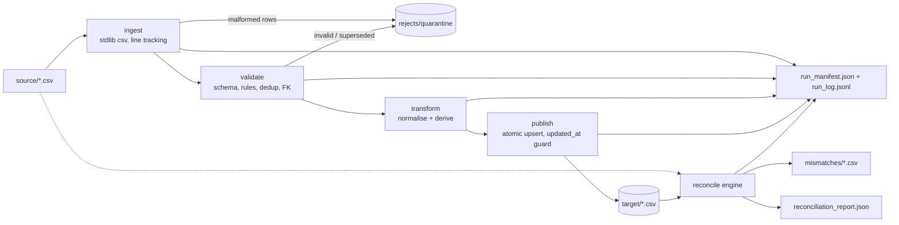

# YottaFlex Data Reconciliation & Ingestion Tool

A deterministic data engineering pipeline and 4-tier source-to-target reconciliation engine built with Python and Pandas. Ingests source customer and order extracts, enforces schema constraints and foreign-key integrity, quarantines defective records with exact physical line-number traceability, transforms data deterministically, publishes target analytical tables idempotently, and performs multi-level reconciliation to isolate all data discrepancies.

---

## 1. Quick Start

Run these commands from a clean clone to verify environment setup, run the test suite, and execute a live end-to-end demonstration:

```bash
# 1. Clone repository
git clone https://github.com/swapnanilchatterjee/yottaflex-recon.git
cd yottaflex-recon

# 2. Install dependencies and install package in editable mode
pip install -r requirements.txt
pip install -e .

# 3. Run full automated test suite (35 tests pass in ~1.3s)
python -m pytest -v

# 4. Run end-to-end demonstration (Mode A clean run & Mode B defect detection)
make demo
```

*(Note: If `make` is not installed on Windows, execute the equivalent Python commands directly:)*
```bash
# Generate reproducible sample datasets with defect injection (seed=42)
python -m recon generate --out data/sample --customers 50 --orders 200 --seed 42

# Mode A: Execute ingestion, validation, transformation, and publishing
python -m recon run --source-dir data/sample/source --target-dir output/target --out-dir output/mode_a

# Mode A: Reconcile published target against source (exits 0, PASS, 0 unexplained differences)
python -m recon reconcile --source-dir data/sample/source --target-dir output/target --out-dir output/mode_a

# Mode B: Reconcile against drifted target (exits 1, FAIL, isolates all 8 injected defects)
python -m recon reconcile --source-dir data/sample/source --target-dir data/sample/target_drifted --out-dir output/mode_b
```

---

## 2. What `make demo` Shows

The demo demonstrates the engine across two distinct operational modes:

1. **Mode A — Pipeline Ingest, Publish & Clean Verification:**
   - Ingests `customers.csv` and `orders.csv`.
   - Validates data types, constraints, and referential integrity; supersedes duplicate keys; quarantines bad records to `output/mode_a/rejects/`.
   - Publishes target clean analytical tables: `output/target/dim_customers.csv` and `output/target/fact_orders.csv`.
   - Executes reconciliation: **Exits with code 0 (PASS)**. Demonstrates the core count equation:

     ```text
     source_raw_rows = expected_target_rows + rejected_rows
     ```

     Every difference is fully accounted for by quarantined rejects (0 unexplained differences).
2. **Mode B — Drift & Corruption Detection:**
   - Reconciles source extracts against `data/sample/target_drifted/` (an independently modified target with deliberate row deletions, phantom rows, duplicate keys, and altered field values).
   - **Exits with code 1 (FAIL - Mismatches Detected)**.
   - Isolates 100% of the defects into structured CSV files inside `output/mode_b/mismatches/` (`missing_in_target.csv`, `extra_in_target.csv`, `duplicate_in_target.csv`, `field_mismatches.csv`).
   - A committed reference of these demo outputs is preserved in `sample_output/`.

---

## 3. Architecture & Data Flow



### Module Responsibilities

| Module | Location | Primary Responsibility |
| :--- | :--- | :--- |
| `recon.schemas` | `src/recon/schemas.py` | Column definitions, regex patterns, reject reason constants, and lineage columns. |
| `recon.ingest` | `src/recon/ingest.py` | Line-by-line CSV parsing, line-number tracking, and ragged row quarantine. |
| `recon.validate` | `src/recon/validate.py` | Schema checking, business rules, duplicate key resolution, and foreign key verification. |
| `recon.transform`| `src/recon/transform.py` | Pure deterministic transformations: Decimal rounding, UTC date formatting, amount banding. |
| `recon.publish` | `src/recon/publish.py` | Atomic idempotent publishing with `updated_at` stale guard and atomic file replace. |
| `recon.reconcile`| `src/recon/reconcile.py` | 4-tier reconciliation engine: counts, keys, aggregates, and vectorised field diffs. |
| `recon.report` | `src/recon/report.py` | Serialization of `reconciliation_report.json` and isolated mismatch CSV reports. |
| `recon.runlog` | `src/recon/runlog.py` | Deterministic `run_id` computation, structured logging, and JSON execution manifests. |
| `recon.generator`| `src/recon/generator.py` | Seeded synthetic dataset generator with defect injection and labelled answer keys. |

Detailed architectural flow documentation is available in [docs/architecture.md](docs/architecture.md).

---

## 4. Data Model & Entities

The pipeline models an e-commerce domain comprising two relational entities:

### 4.1 Entity Specifications
- **`customers` (Parent Entity):**
  - **Grain:** One row per customer account.
  - **Primary Key:** `customer_id` (format: `^C\d{6}$`, e.g. `C000001`).
  - **Attributes:** `customer_name` (mandatory), `email` (optional), `country_code` (2 letters), `created_at`, `updated_at`.
  - **Target Table:** `dim_customers.csv`.
- **`orders` (Child Entity):**
  - **Grain:** One row per order event.
  - **Primary Key:** `order_id` (format: `^O\d{8}$`, e.g. `O00000001`).
  - **Foreign Key:** `customer_id` referencing a valid, non-quarantined customer in `dim_customers`.
  - **Attributes:** `order_ts` (must not be in future), `status` (allowed set), `amount` (range `[0.00, 1000000.00]`), `currency` (allowed set), `updated_at`.
  - **Target Table:** `fact_orders.csv`.

### 4.2 Target Lineage Columns
Both published target tables append two lineage audit columns:
- `source_file`: The origin input filename (e.g. `orders.csv`).
- `run_id`: The deterministic execution run identifier (e.g. `run_d17f36aa8c8d`).

> **Reconciliation Policy:** Lineage columns (`source_file`, `run_id`) are explicitly excluded from data drift comparisons (`RECON_EXCLUDE_COLUMNS`) so that pipeline operational metadata does not trigger false positive business data mismatches.

Complete column constraints, data types, nullability, and derivations are documented in [docs/DATA_DICTIONARY.md](docs/DATA_DICTIONARY.md).

---

## 5. Naming & Lineage Conventions

- **Naming Convention:** All table names, column names, and file names strictly follow `snake_case` using lowercase alphanumeric characters separated by underscores (`_`). Examples: `customer_id`, `dim_customers.csv`, `order_ts_utc`.
- **Timestamp Standard:** Canonical ISO-8601 UTC with explicit `Z` suffix (`YYYY-MM-DDTHH:MM:SSZ`). Timestamps containing timezone offsets (e.g. `+05:30`) are converted to UTC during the transform stage.
- **Deterministic Run Identifier (`run_id`):**
  Computed deterministically from the SHA-256 hash of all input file bytes concatenated with the pipeline version string:
  ```
  run_id = "run_" + sha256(input_files_content_bytes + PIPELINE_VERSION)[:12]
  ```
  Example: `run_d17f36aa8c8d`.
  Rerunning the pipeline on identical input files guarantees the exact same `run_id`, allowing automated monitoring tools to immediately recognize reruns.

---

## 6. Business Rules & Quarantine Policy

No record is ever dropped silently. Every defective record is persisted to `rejects/<entity>_rejects.csv` with full audit context:
`run_id, source_file, source_line_number, entity, business_key, reason_code, reason_detail, raw_record`.

| Reject Reason Code | Triggering Condition |
| :--- | :--- |
| `MALFORMED_ROW` | Ragged line in source CSV where the number of fields does not match the header count. |
| `MISSING_REQUIRED` | Any required field is blank or whitespace-only. |
| `INVALID_FORMAT` | Business key or field violates regex (e.g. `customer_id` not matching `^C\d{6}$` or `country_code` not 2 letters). |
| `INVALID_TYPE` | Timestamp string cannot be parsed as ISO-8601, or amount is not a valid decimal. |
| `INVALID_VALUE` | Amount < 0.00 or > 1,000,000.00; status not in allowed set; currency not in allowed set; or `updated_at < created_at`. |
| `FUTURE_TIMESTAMP` | Order timestamp is in the future relative to pipeline execution time. |
| `INVALID_FK` | Order references a `customer_id` that does not exist among valid customer records. |
| `DUPLICATE_SUPERSEDED` | Intra-batch duplicate key: earlier version superseded by the version with the highest `updated_at`. |

---

## 7. 4-Tier Reconciliation Methodology

Reconciliation operates across 4 complementary tiers:

```
Tier 1: Row Count Equation   -> source_raw_rows = expected_target_rows + rejected_rows
Tier 2: Business Key Sets    -> missing_in_target, extra_in_target, duplicate_in_target
Tier 3: Domain Aggregates    -> sum(amount) [tol=0.005], min/max, distinct customers
Tier 4: Vectorised Field Diff-> Inner-join on PK; vectorised comparison of payload attributes
```

### Exit Codes for Orchestration
- `0` — **Clean PASS:** 0 unexplained count differences, 0 key differences, 0 aggregate failures, 0 field mismatches.
- `1` — **Reconciliation FAIL:** One or more data differences detected and isolated into mismatch CSV files.
- `2` — **Fatal Pipeline Error:** Missing required header columns, zero-byte source files, or file access error.

---

## 8. Idempotency, Reruns, and Late Data

1. **Rerun Invariance:** Re-executing `python -m recon run` on identical source data produces:
   - Identical target file SHA-256 checksums.
   - Run metrics: `{'inserted': 0, 'updated': 0, 'unchanged': N, 'skipped_stale': 0}`.
2. **Late-Arriving Stale Data Guard:** Target updating evaluates version timestamps (`updated_at_utc`). Incoming records with older version timestamps than existing target records are counted as `skipped_stale` and prevented from clobbering newer analytical data.
3. **Crash Protection (Atomic Swaps):** Target CSVs are written to temporary files (`tmp_publish_*.csv`) in the destination directory and replaced atomically via `os.replace`. A crashed job leaves the previous verified target intact.

---

## 9. QA Test Report (Tester Verification)

A comprehensive quality assurance suite was executed covering unit, negative, boundary, edge-case, idempotency, and integration scenarios.

### 9.1 Test Execution Summary
- **Test Runner:** `pytest 9.2.0`
- **Total Test Cases:** **35 Passed** (0 Failed, 0 Skipped)
- **Execution Time:** **1.27 seconds**
- **Test Evidence File:** `docs/evidence/pytest.txt`

### 9.2 QA Test Matrix & Coverage

| Test Category | Test File & Name | Target Scenario | Verification Result |
| :--- | :--- | :--- | :--- |
| **Ingestion Resilience** | `test_ingest.py::test_zero_byte_file` | Zero-byte source CSV | `EMPTY_FILE_NO_HEADER` raised |
| **Ingestion Resilience** | `test_ingest.py::test_missing_file_raises_not_found` | Missing CSV file path | `FILE_NOT_FOUND` raised |
| **Ingestion Resilience** | `test_ingest.py::test_missing_column_fails_with_schema_error`| Header missing mandatory column | `SCHEMA_MISSING_COLUMNS` raised |
| **Ingestion Resilience** | `test_ingest.py::test_extra_column_ignored_with_warning` | Extra column in source CSV | Column ignored, warning logged |
| **Ingestion Resilience** | `test_ingest.py::test_malformed_row_quarantined` | Ragged row (too few or extra fields) | Quarantined `MALFORMED_ROW` with physical line number |
| **Validation Rules** | `test_validate.py::test_row_conservation` | Invariant: `len(input) == len(valid) + len(rejects)` | Exact row conservation verified |
| **Validation Rules** | `test_validate.py::test_missing_required` | Blank required string field | Quarantined `MISSING_REQUIRED` |
| **Validation Rules** | `test_validate.py::test_null_email_allowed` | Null/empty email address | Validated; email blank in target |
| **Validation Rules** | `test_validate.py::test_duplicate_keeps_latest` | Duplicate key with newer `updated_at` | Newer kept, older `DUPLICATE_SUPERSEDED` |
| **Validation Rules** | `test_validate.py::test_exact_duplicate` | Identical duplicate event lines | One kept, duplicate superseded |
| **Validation Rules** | `test_validate.py::test_out_of_order_duplicates` | Newer record appears first in file | Highest `updated_at` wins |
| **Validation Rules** | `test_validate.py::test_orphan_customer_rejected` | Order with unknown customer ID | Quarantined `INVALID_FK` |
| **Validation Rules** | `test_validate.py::test_future_timestamp_rejected`| Order timestamp in the future | Quarantined `FUTURE_TIMESTAMP` |
| **Validation Rules** | `test_validate.py::test_invalid_customer_id_format`| Customer ID without `C` prefix | Quarantined `INVALID_FORMAT` |
| **Validation Rules** | `test_validate.py::test_invalid_country_code_format`| Country code with 3 letters | Quarantined `INVALID_FORMAT` |
| **Validation Rules** | `test_validate.py::test_updated_at_earlier_than_created_at_rejected`| `updated_at < created_at` | Quarantined `INVALID_VALUE` |
| **Validation Rules** | `test_validate.py::test_amount_out_of_range_rejected`| Negative amount and amount > 1M | Quarantined `INVALID_VALUE` |
| **Validation Rules** | `test_validate.py::test_invalid_status_and_currency_rejected`| Unrecognized status and currency | Quarantined `INVALID_VALUE` |
| **Transformations** | `test_transform.py::test_amount_rounding_half_up` | Decimal HALF_UP quantisation | `10.005 -> 10.01`, `10.004 -> 10.00` |
| **Transformations** | `test_transform.py::test_band_boundaries` | Boundary values 99.99, 100.00, 999.99, 1000.00 | Correct `low`, `medium`, `high` bands |
| **Transformations** | `test_transform.py::test_offset_to_utc` | Timezone offset `+05:30` | Normalised to UTC ending in `Z` |
| **Transformations** | `test_transform.py::test_status_currency_normalised`| Whitespace noise `" PAID "`, `"usd"` | Normalised to `paid` and `USD` |
| **Idempotency** | `test_publish_idempotency.py::test_rerun_no_duplicates` | Rerunning identical batch | `inserted=0, updated=0`, hash identical |
| **Idempotency** | `test_publish_idempotency.py::test_stale_update_does_not_overwrite` | Late data with older version timestamp| Counted as `skipped_stale`, target intact |
| **Idempotency** | `test_publish_idempotency.py::test_publish_empty_dataframe` | Publishing 0 valid records | Empty target created with header |
| **Reconciliation** | `test_reconcile.py::test_amount_tolerance` | Amount diff of 0.004 vs 0.006 against a 0.005 tolerance | 0.004 passes, 0.006 flags mismatch |
| **Reconciliation** | `test_reconcile.py::test_aggregate_mismatch_flagged` | Target aggregate sum corrupted | Failing aggregate named in report |
| **Reconciliation** | `test_reconcile.py::test_key_differences` | Injected missing and extra keys | Correct key sets isolated |
| **Reconciliation** | `test_reconcile.py::test_reconcile_handles_missing_target_file_gracefully` | Target file completely missing | Flags all source keys as missing |
| **Seeded Generator** | `test_generator_labels.py::test_same_seed_same_bytes` | Seed 12345 run twice | Byte-identical files generated |
| **Seeded Generator** | `test_generator_labels.py::test_recon_matches_injected_labels` | Drifted target audit | 100% of injected defects identified |
| **Edge Cases** | `test_edge_cases.py::test_empty_batch` | Header-only empty batch | `SUCCESS_EMPTY`, 0 rows, recon PASS |
| **Edge Cases** | `test_edge_cases.py::test_missing_column_fails_run` | Run on file with missing column | Exits with code 2 |
| **Edge Cases** | `test_edge_cases.py::test_publish_crash_leaves_target_intact_then_retry_succeeds` | Crash simulated during atomic write | Target intact, retry succeeds |
| **Integration** | `test_end_to_end.py::test_happy_path_pipeline_and_reconcile`| Generate -> Run -> Reconcile | Manifest recorded, report PASS |

### 9.3 Mutation Testing (Proof of Detection)
To verify that the reconciliation engine is sensitive to corruptions rather than a false-positive rubber stamp, a mutation test was conducted:
1. `output/target/fact_orders.csv` was modified by corrupting a single amount from `99.99` to `119.99`.
2. Running `python -m recon reconcile` immediately flagged `sum_amount` aggregate failure, isolated the order key in `field_mismatches.csv`, and exited with code 1.
3. Reverting the file returned the result to `PASS` with exit code 0.

---

## 10. Performance Benchmarks & Optimization

Measured on an Intel/AMD x86_64 system running Windows 11 with Python 3.10.11:

### 10.1 Stage Timings for 100,000 Orders (10,000 Customers)

| Pipeline Phase | Measured Duration | Throughput |
| :--- | :--- | :--- |
| **Ingestion** | `0.793 s` | ~126,100 rows/s |
| **Validation & Deduplication** | `33.803 s` | ~2,960 rows/s |
| **Transformation** | `13.797 s` | ~7,250 rows/s |
| **Publishing (Atomic Upsert)** | `0.631 s` | ~158,500 rows/s |
| **Reconciliation (4 Tiers)** | `49.255 s` | ~2,030 rows/s |
| **Total End-to-End** | **98.280 s** | **~1,017 rows/s** |

### 10.2 Optimization Study: Vectorised Merge vs Naive Row Loop
During field-level reconciliation, comparing all attributes row-by-row with `iterrows` introduces massive Python interpreter overhead. We implemented a vectorised inner-join using Pandas and NumPy column masks.

- **Naive `iterrows` Loop (15,000 rows):** `2.445 s`
- **Vectorised Pandas Merge (15,000 rows):** `0.104 s`
- **Measured Speedup:** **23.5x faster**

Full benchmark logs are preserved in [docs/PERFORMANCE.md](docs/PERFORMANCE.md) and [docs/evidence/benchmark.txt](docs/evidence/benchmark.txt).

---

## 11. Known Limitations & Next Steps

1. **In-Memory Scale Limit:** Designed for datasets up to ~1,000,000 records. For larger datasets (>1M rows), transition execution to **DuckDB** or **PySpark**.
2. **File Storage Format:** Currently outputs CSVs for inspection. In production, migrate target storage to columnar **Apache Parquet** partitioned by `order_date`.
3. **History Preservation:** Superseded duplicates currently reside in quarantine. Next step: implement an append-only Slowly Changing Dimension Type 2 (SCD2) history table with `valid_from` and `valid_to` timestamps.
4. **Orchestration:** Add Apache Airflow DAGs with Slack notifications triggered on exit code 1.

Detailed architectural trade-offs are documented in [docs/DESIGN_NOTES.md](docs/DESIGN_NOTES.md).

---

## 12. AI Collaboration Disclosure

This project was built in collaboration with the Antigravity AI coding CLI (Google Gemini 3.8 Flash).
- All AI interaction prompts are logged with timestamps in [prompts/PROMPT_HISTORY.md](prompts/PROMPT_HISTORY.md).
- Human review, design validation, precision adjustments, and caught edge cases are fully disclosed in [docs/AI_USAGE.md](docs/AI_USAGE.md).
