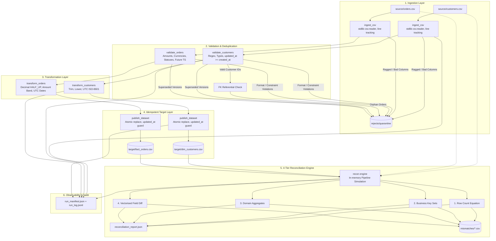

# System Architecture & Flow Design

The diagram below illustrates the end-to-end data lifecycle, from source extraction and resilient ingestion to idempotent publishing, quarantine routing, and 4-tier reconciliation.

---

## 1. Architectural Workflow Diagram

---

## 2. Component Responsibility Matrix

| Module | Core Function | Failure Mode / Handling |
| :--- | :--- | :--- |
| `recon.ingest` | Reads CSV line-by-line; attaches physical line numbers. | Quarantines malformed field-count rows as `MALFORMED_ROW`. Missing required header column fails run (`SCHEMA_MISSING_COLUMNS`). |
| `recon.validate` | Applies business rules, regex formats, and inter-entity FK checks. | Quarantines failing records with explicit reason code; supersedes older versions with `DUPLICATE_SUPERSEDED`. Invariant: `input == valid + rejects`. |
| `recon.transform` | Pure deterministic conversions: Decimal `ROUND_HALF_UP`, UTC dates, amount banding. | Deterministic sorting by PK ensuring reproducible output bytes. |
| `recon.publish` | Updates target datasets idempotently. | Guarded upsert: rows with older `updated_at` are skipped (`skipped_stale`). Writes to temp file then atomic `os.replace`. |
| `recon.reconcile` | Compares expected target vs actual target across 4 tiers. | Solves count equation; isolates missing, extra, duplicate, and mismatched fields into discrete CSVs. |
| `recon.runlog` | Computes content-hash `run_id`, logs structured events, records run manifest. | Non-zero exit code on failure, persists attempt number and failure reason. |
